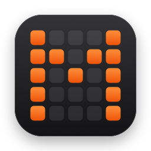
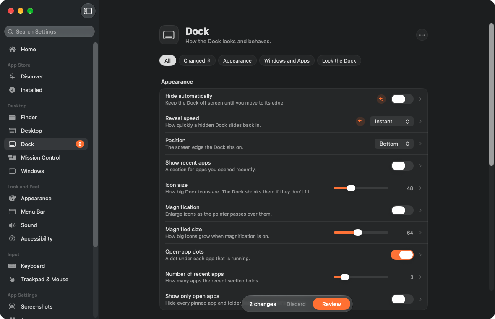
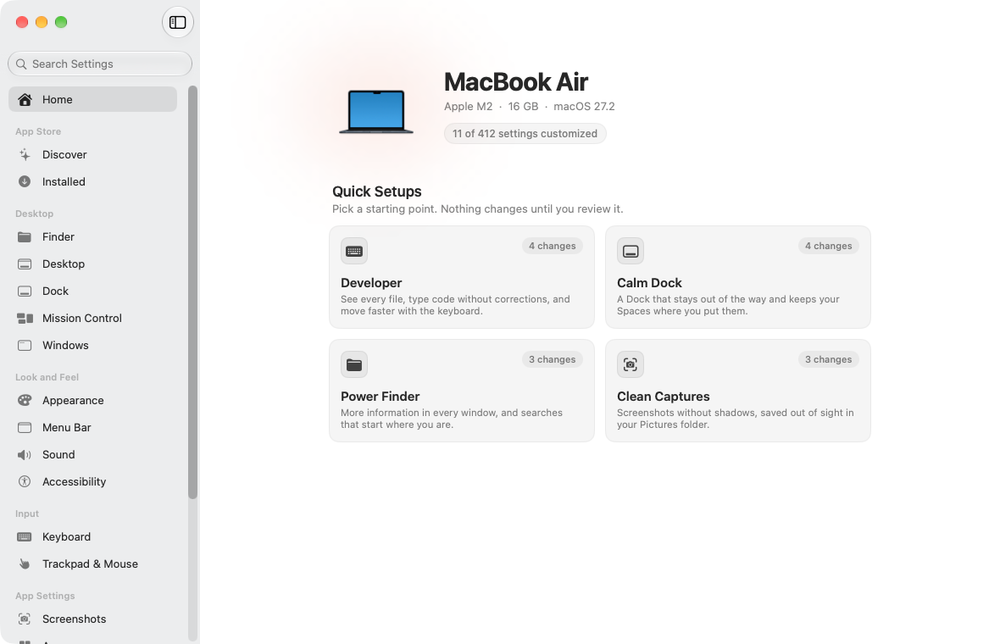

<div align="center">



# MacKit

**Tune your Mac from one calm window.**
412 macOS settings with plain-language names, a review step, and exact undo.<br>
Plus an app store that installs straight from the maker.

[Features](#features) · [Build](#build) · [Try it safely](#try-it-safely) · [How it stays safe](#how-it-stays-safe) · [Status](#status)

<br>



</div>

## Features

- **412 settings in 18 categories.** Finder, Dock, Mission Control, menu bar, keyboard, trackpad, screenshots, power, sharing, and more. Each one is checked against macOS 27.
- **Plain words.** "Show hidden files", not `AppleShowAllFiles`. The Terminal command behind any change is one click away if you want it.
- **Review before anything risky.** Small, safe settings apply as you change them. Anything that needs a password, carries a caution, or restarts Finder waits in a review sheet first.
- **Exact undo.** MacKit records the previous value before every write. History puts it back, one change or a whole batch.
- **Quick Setups.** Developer, Calm Dock, Power Finder, and Clean Captures apply a handful of related changes together, always through review.
- **An app store.** About 3,500 apps from Homebrew Cask's public catalog, downloaded from the maker, checksum-verified, and checked by macOS before they reach Applications. Homebrew itself is not needed.
- **Native.** SwiftUI and AppKit, system controls, Liquid Glass icon. No web views, no third-party UI.

<div align="center">

</div>

## Build

MacKit needs macOS 27 and Xcode 27. There is no downloadable release yet.

Open `MacKit.xcodeproj` and press Run, or build from Terminal:

```bash
xcodebuild -project MacKit.xcodeproj -scheme MacKit -derivedDataPath build build
```

```bash
open build/Build/Products/Debug/MacKit.app
```

## Try it safely

Sample mode runs the whole app, including applying and undoing, against an in-memory Mac. No real setting is read or written.

```bash
open build/Build/Products/Debug/MacKit.app --args -sample 1
```

## How it stays safe

- **Only known settings.** The catalog is a fixed list in the source. MacKit never downloads or runs scripts, and it can only launch a short allowlist of system tools.
- **Your password stays with macOS.** Administrator changes go through the system's own prompt, once per batch. One failed change never stops or hides the others.
- **Downloads are treated as untrusted.** HTTPS only, checksum verified when the catalog has one, marked as downloaded, and confirmed by Gatekeeper before anything in Applications is replaced. The copy being replaced goes to the Trash, not away.
- **Everything is in the open.** Every setting, the command it runs, and the tests behind it are in this repository.

## Project layout

```
MacKit/                  The app (SwiftUI)
Packages/MacKitCore/     The engine: catalog, planning, apply, undo, installer. No UI.
Tools/make-icon.swift    Draws the app icon
```

Run the engine's tests. They use an in-memory Mac and locally built fake apps, so nothing real is touched:

```bash
swift test --package-path Packages/MacKitCore
```

## Status

Early, and honest about it:

- **Unsigned.** There is no Developer ID yet, so macOS will warn on first launch of a copied build.
- **Administrator changes** are tested on a real system for power settings and system preference files. Touch ID for sudo has not been confirmed end to end.
- **The app store** is tested with locally built apps only.

Issues and pull requests are welcome. `PLAN.md` has the full history and what comes next.

## License

[MIT](LICENSE)
